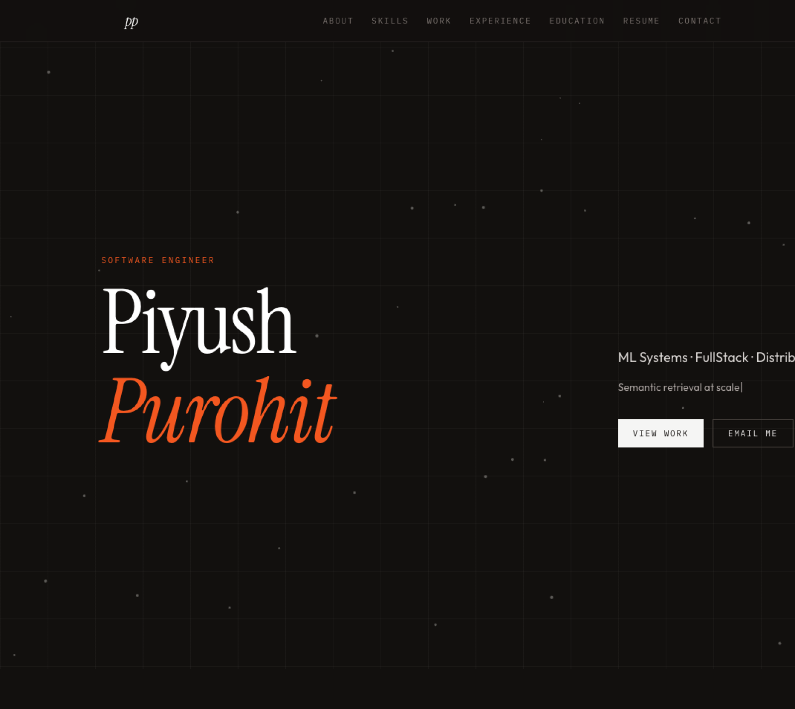

# Piyush Purohit — Portfolio



Personal site for [Piyush Purohit](https://github.com/piyush474): ML systems, fullstack, and distributed systems.

## Stack

- Vite + React 18
- Tailwind CSS (class-based light / dark mode, dark by default)
- Canvas snowfall in the background

## Local development

```bash
npm install
npm run dev
```

The app runs at [http://localhost:5173](http://localhost:5173).

## Content

- Personal links: `src/site.js`
- Projects: `src/registry.js` — set `prodUrl` when a demo ships
- Resume: [`public/resume/PiyushPurohit_Resume.pdf`](public/resume/PiyushPurohit_Resume.pdf)

## Analytics

Visitor and click tracking uses [Umami Cloud](https://cloud.umami.is) (Hobby is free: 100k events/month, unique visitors, custom events, no cookies). Vercel Web Analytics on Hobby only covers page views; custom click events need a paid Vercel plan.

The live site ID is already wired. Local clicks are not sent unless you set `VITE_UMAMI_TRACK_LOCAL=true`. Event names live in `src/lib/analytics.js`.

## Build

```bash
npm run build    # outputs to dist/
npm run preview  # preview the production build
```
